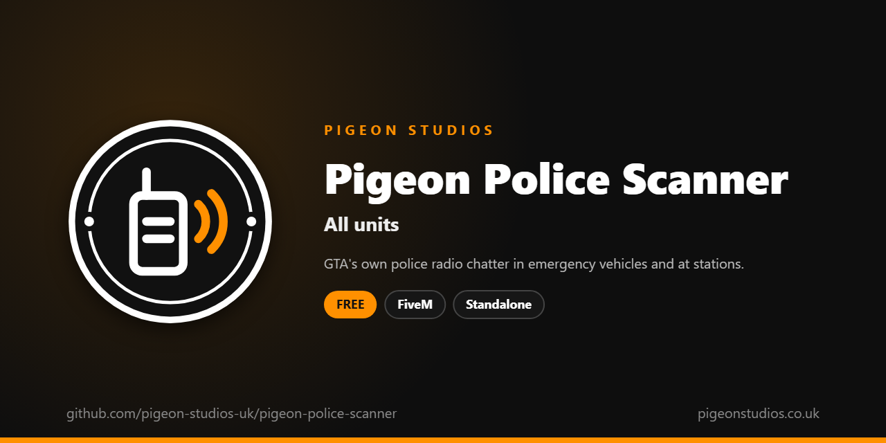

<div align="center">
  

  <h1>Pigeon Police Scanner</h1>

  <p><strong>GTA's own police radio chatter in and near emergency vehicles, at police stations, or for on-duty police.</strong></p>

  <p>
    <a href="https://github.com/pigeon-studios-uk/pigeon-police-scanner/releases/latest"></a>
    <a href="LICENSE.md"></a>
    <a href="https://discord.gg/2NFVWEUmDF"></a>
    
  </p>

  <p>
    <a href="https://github.com/pigeon-studios-uk/pigeon-police-scanner/releases/latest"><strong>Download</strong></a> ·
    <a href="#installation">Install</a> ·
    <a href="#configuration">Configure</a> ·
    <a href="CHANGELOG.md">Changelog</a> ·
    <a href="https://discord.gg/2NFVWEUmDF">Support</a>
  </p>
</div>

---

## Contents

- [Overview](#overview)
- [Features](#features)
- [Requirements](#requirements)
- [Installation](#installation)
- [Updating](#updating)
- [Configuration](#configuration)
- [Localisation](#localisation)
- [Commands and exports](#commands-and-exports)
- [How it works](#how-it-works)
- [Update checker](#update-checker)
- [Performance](#performance)
- [Security](#security)
- [Troubleshooting](#troubleshooting)
- [FAQ](#faq)
- [Support](#support)
- [Contributing](#contributing)
- [Licence](#licence)
- [Credits](#credits)

## Overview

Pigeon Police Scanner is a free resource by [Pigeon Studios](https://pigeonstudios.co.uk) that brings back the police radio. In single player, GTA's dispatcher talks over the radio about crimes and suspects across the city. On FiveM servers that chatter is gone, and patrol cars are silent.

This resource plays GTA's own police radio reports every minute or two, only where a scanner would be: in or next to a police car, ambulance or fire truck, or at a police station. Servers running Qbox, QBCore or ESX can also have on-duty police hear it everywhere. Each player hears it on their own, and can turn it off with `/scanner`.

## Features

- **GTA's own voices.** The game's real police radio reports, no sound files to download.
- **Where it makes sense.** In or near emergency vehicles and at police stations, and you choose which.
- **For on-duty police.** Optionally everywhere for police on duty on Qbox, QBCore and ESX.
- **Not too chatty.** A random gap of 1 to 3 minutes, never the same report twice in a row.
- **Players choose.** `/scanner` turns it off and on, and it's remembered next time they join.
- **Easy to check.** `/scanner test` plays each report in turn so you can pick the ones you like.
- **23 languages.** Follows ox_lib's language, or set your own.
- **Standalone.** No framework or other resources needed.

## Requirements

| Requirement | Version | Notes |
|---|---|---|
| FXServer | A [recommended artifact](https://runtime.fivem.net/artifacts/) | |
| [ox_lib](https://github.com/communityox/ox_lib) | Optional | Used for messages and the language if it's running |

**Frameworks:** none needed. It works the same on standalone and vMenu servers, ESX Legacy, QBCore, Qbox and ox_core.

## Installation

1. **Download** `pigeon-police-scanner.zip` from the [latest release](https://github.com/pigeon-studios-uk/pigeon-police-scanner/releases/latest). Don't use the green **Code** button; release zips are the tested builds.
2. **Extract** it into your server's `resources` folder. The folder must be called `pigeon-police-scanner`.
3. **Start it** by adding this to `server.cfg`, after ox_lib if you use it:

   ```cfg
   ensure pigeon-police-scanner
   ```

4. **Configure** it in `configuration/config.lua` if you want to change anything. The defaults work as they are.
5. **Restart** your server. The console shows one line from the update checker:

   ```text
   [Pigeon Studios] Pigeon Police Scanner v1.0.0 is up to date.
   ```

## Updating

1. Read the [changelog](CHANGELOG.md) for every version between yours and the latest, especially any **Upgrade notes**.
2. Back up your `configuration/` and `locales/` folders.
3. Replace the `pigeon-police-scanner` folder with the new release.
4. Copy your changed settings into the new `configuration/config.lua`. Don't copy the old file over the new one; new versions can add settings.
5. Restart the resource.

## Configuration

All settings are in `configuration/config.lua`, each explained by a comment next to it.

| Setting | Default | What it does |
|---|---|---|
| `Config.Locale` | `'auto'` | The language. `'auto'` follows ox_lib's; or a code such as `'de'` (see [Localisation](#localisation)) |
| `Config.Command` | `'scanner'` | The command players use |
| `Config.Where` | `see below` | Where players hear it: `InEmergencyVehicle`, `NearEmergencyVehicle`, `AtStations`, `PoliceJob`, `Everywhere` |
| `Config.NearDistance` | `10.0` | Metres from an emergency vehicle that count as near it |
| `Config.StationRadius` | `50.0` | Metres from a station that count as at it |
| `Config.Stations` | `Mission Row, Sandy Shores, Paleto Bay` | Police stations; add your map's own |
| `Config.PoliceJobs` | `police, sheriff, bcso…` | Jobs that count as police, for `PoliceJob` |
| `Config.MinSeconds` | `60` | The shortest gap between reports |
| `Config.MaxSeconds` | `180` | The longest gap between reports |
| `Config.ShowMessages` | `true` | Tell players when they turn it off and on |
| `Config.Notifications` | `'auto'` | `'auto'` (ox_lib if it's running), `'ox_lib'` or `'gta'` |
| `Config.Reports` | `50 of GTA's reports` | The reports it picks from |

## Localisation

Pigeon Police Scanner comes in 23 languages: `en` English, `cs` Czech, `da` Danish, `de` German, `es` Spanish, `et` Estonian, `fi` Finnish, `fr` French, `hr` Croatian, `hu` Hungarian, `id` Indonesian, `it` Italian, `nl` Dutch, `no` Norwegian, `pl` Polish, `pt` Portuguese, `pt-br` Brazilian Portuguese, `ro` Romanian, `sl` Slovenian, `sv` Swedish, `tr` Turkish, `zh-cn` Simplified Chinese and `zh-tw` Traditional Chinese. They're the languages ox_lib ships, so your server may already have one set.

With `Config.Locale = 'auto'` (the default), it uses ox_lib's language, so one line in `server.cfg` sets it for this and every other resource that follows ox_lib:

```cfg
setr ox:locale "de"
```

Use `setr`, not `set`, so players' games get it too. Without it, or for a language that isn't in `locales/`, the text is English. To choose a language for this resource only, set `Config.Locale` to its code, such as `'fr'` or `'pt-br'`.

Chinese text can show as blank in GTA's own text, such as its notifications, because GTA only loads its Chinese font when the game itself is set to Chinese. ox_lib's notifications show every language.

Every file was checked for missing text and placeholders, but not every translation has been read by a native speaker yet. If something reads wrong, please send a fix; see [Contributing](#contributing). To add a language, copy `locales/en.lua` to a new file named with the language's code (such as `ja.lua`), change `Locales.en` at the top to match (`Locales.ja`), and translate the text in quotes.

## Commands and exports

### Commands

| Command | Who | What it does |
|---|---|---|
| `/scanner` | Everyone | Turn the scanner off, or on again. Remembered next time |
| `/scanner on` / `off` | Everyone | Turn it on or off |
| `/scanner test` | Everyone | Play the next report in `Config.Reports`, and say which it is |
| `/scanner test <number>` | Everyone | Play that report |

The test only plays to the player who runs it, so it's safe for anyone to use.

### Where players hear it

`Config.Where` sets where the scanner plays. Any that's `true` is enough:

| Setting | Default | Hears it |
|---|---|---|
| `InEmergencyVehicle` | `true` | Sitting in a police car, ambulance or fire truck (GTA's emergency vehicle class) |
| `NearEmergencyVehicle` | `true` | On foot within `Config.NearDistance` of one, as if its radio was on |
| `AtStations` | `true` | Within `Config.StationRadius` of one of `Config.Stations` |
| `PoliceJob` | `false` | Anywhere, while on duty in a police job on Qbox, QBCore or ESX |
| `Everywhere` | `false` | Anywhere at all |

For `PoliceJob`, a job counts as police if it's in `Config.PoliceJobs`, or on Qbox and QBCore if its type is `leo`. Players who are off duty don't hear it.

### Exports

Client exports, for other resources in the player's game:

```lua
-- Turn the scanner off (false) or on (true) for this player, for example from a radio or phone resource.
exports['pigeon-police-scanner']:SetEnabled(false)

-- True while the player is somewhere they hear it, with it on.
local listening = exports['pigeon-police-scanner']:IsListening()
```

## How it works

Every 2 seconds, the player's game checks whether they're somewhere in `Config.Where`: in an emergency vehicle (GTA's vehicle class 18), near one, at a station, or on duty as police on a framework. When they start listening, the first report plays within 15 seconds, then one every `Config.MinSeconds` to `Config.MaxSeconds`, picked at random from `Config.Reports` and never the same twice in a row. When they stop listening, any report playing is cut off.

The reports are GTA's own scripted scanner reports, played with `PlayPoliceReport`. They're the game's audio, so there's nothing to download, and only that player hears them. The 50 in the list were made for the story, so they mention crimes, vehicles and places in Los Santos and Blaine County; use `/scanner test` to listen through them and remove any that don't suit your server.

`/scanner` saves each player's choice in their game, so it stays off for them until they turn it back on.

## Update checker

When it starts, Pigeon Police Scanner checks our public [version registry](https://github.com/pigeon-studios-uk/pigeon-versions) once and prints one line in the server console saying whether it's up to date. If there's an update, it shows what's new and where to get it. The check is a single request to GitHub and sends nothing about your server or players.

Control it for every Pigeon Studios resource at once in `server.cfg`:

```cfg
set pigeon_update_check "on"      # default: one line per resource
set pigeon_update_check "quiet"   # only when there's an update or a problem
set pigeon_update_check "off"     # never check
```

## Performance

It checks where the player is every 2 seconds: their vehicle, and the distance to nearby vehicles and three stations. That's well under a millisecond. Reports are GTA's own sounds, played by the game. Nothing runs on the server apart from the update check at start-up.

## Security

- It runs only in each player's own game, and only plays sounds to that player.
- It has no network events, so there is nothing other players or the server can send it. The exports can only be called by resources in the player's own game.
- It only reads the player's job from the framework; it never changes it.
- The only network request is the update check at start-up, from the server to GitHub. It sends nothing about your server or players.

Found a problem? Please don't open a public issue. Use the **Report a vulnerability** button in this repository's **Security** tab, or follow our [Security Policy](https://github.com/pigeon-studios-uk/.github/blob/main/SECURITY.md).

## Troubleshooting

**I don't hear anything in a police car.**
Wait up to 15 seconds for the first report. Check `/scanner` hasn't been turned off, and that GTA's sound volume isn't down. Modded police cars must be in GTA's emergency class (18) to count; most are.

**On-duty police don't hear it on foot.**
Set `Config.Where.PoliceJob = true`, and check their job is in `Config.PoliceJobs` (or has type `leo` on Qbox and QBCore) and they're on duty.

**A report doesn't fit my server.**
Use `/scanner test` to find its number and name, and remove that line from `Config.Reports`.

**A station on my map doesn't count.**
Add its coordinates to `Config.Stations` as `vector3(x, y, z)`. Only the three stations with GTA interiors are there by default.

**The text is in the wrong language.**
Check `setr ox:locale` in `server.cfg` (with `setr`, not `set`), or set `Config.Locale` to the language's code.

**The console says "isn't in the version registry" or "couldn't check for updates".**
Your server couldn't reach GitHub, or the check is blocked by a firewall. The resource works normally either way. Turn the check off with `set pigeon_update_check "off"`.

## FAQ

**Is it really free?**
Yes. Use it on as many servers as you like, including ones that take donations. You just can't reupload, resell or bundle it. See [Licence](#licence).

**Does it work on standalone and vMenu servers?**
Yes. It needs no framework at all, and works alongside vMenu.

**Does everyone nearby hear the same report?**
No. Each player's game picks its own, so two players in the same car may hear different reports.

**Does it play in all vehicles?**
Only emergency vehicles: police, ambulances and fire trucks.

**Can I make it louder or quieter?**
It's GTA's own audio, so it follows each player's sound volume in GTA's audio settings. There's no separate volume for it.

## Support

Read [Troubleshooting](#troubleshooting) first, then ask in the support channels of our [Discord](https://discord.gg/2NFVWEUmDF). Please include your Pigeon Police Scanner version, FXServer artifact and any errors from the console (F8 in game). See [Getting help](https://github.com/pigeon-studios-uk/.github/blob/main/SUPPORT.md).

Found a bug? Open a [bug report](https://github.com/pigeon-studios-uk/pigeon-police-scanner/issues/new/choose).

## Contributing

Fixes, improvements and translations are welcome. Please read the [contributing guide](https://github.com/pigeon-studios-uk/.github/blob/main/CONTRIBUTING.md) first, and open a feature request before working on anything big.

## Licence

Pigeon Police Scanner is free to use under the **[Pigeon Studios Free Licence](LICENSE.md)**.

- ✅ Use it on any number of servers, including monetised ones
- ✅ Change it for your own servers
- ✅ Show it in videos and streams
- ❌ Don't reupload, share or mirror the files; link to this repository instead
- ❌ Don't sell it, bundle it in packs, or put it behind escrow
- ❌ Don't remove the credits

This summary isn't the licence; [LICENSE.md](LICENSE.md) is. Third-party components are listed in [NOTICE.md](NOTICE.md).

## Credits

Made by [Pigeon Studios](https://pigeonstudios.co.uk). Thanks to everyone who has contributed fixes and translations; see the [changelog](CHANGELOG.md).

<sub>Not affiliated with or endorsed by Rockstar Games, Take-Two Interactive or Cfx.re.</sub>
